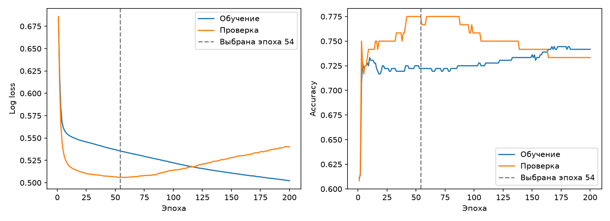
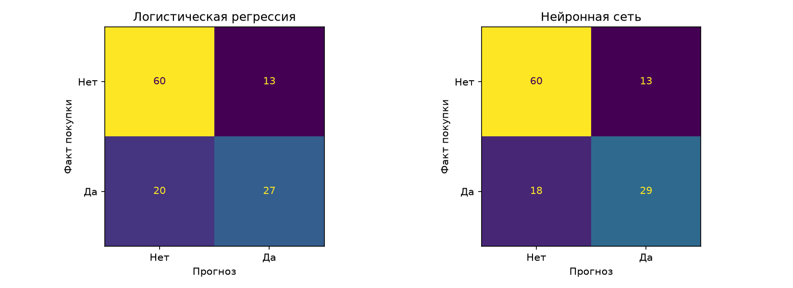
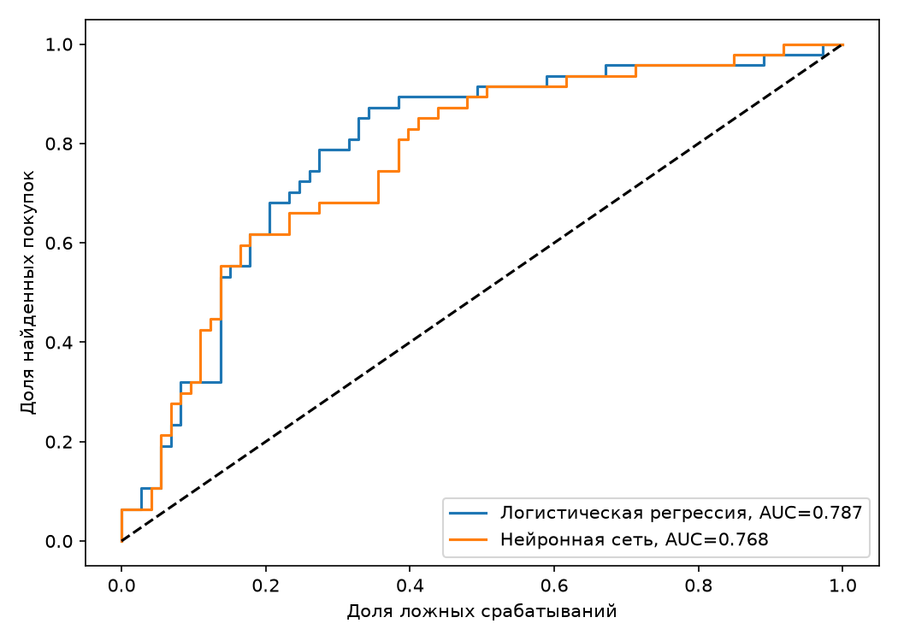

# Задание №4. Прогнозирование покупки с помощью нейронной сети

## Исходные данные

Взяты те же 600 клиентов из задания №1. Исходный файл `data/customers.csv` скопирован из ветки `assignment-1` без изменений. Признаки: возраст, средний чек и число покупок за последние полгода. CustomerID используется только как номер клиента.

В условиях заданий есть несоответствие: в №1 выполнялась кластеризация K-средних, а в №4 требуется сравнить модели прогнозирования покупки. В исходных данных нет факта будущей покупки. Поэтому для этой работы добавлен искусственный столбец Purchase: 1 — клиент совершил покупку в следующем периоде, 0 — не совершил. Для сравнения отдельно обучена логистическая регрессия. В первом задании такой модели и такой целевой переменной не было.

Вероятность покупки задана через формулу:

`s = -0,6 + 0,16 × (частота - 7) + 0,006 × (чек - 140) - 0,012 × (возраст - 42) + 0,9 × I`.

Здесь I равен 1, если частота не меньше 8 и чек не меньше 140 долларов, иначе 0. Затем вычисляется `p = 1 / (1 + exp(-s))`, и покупка случайно генерируется с вероятностью p. Формула и random_state=42 фиксированы заранее. Получено 234 покупателя и 366 клиентов без покупки. Новая таблица сохранена отдельно в `data/customers_with_purchase.csv`.

Это учебная модель поведения, а не наблюдения реального магазина. Нельзя считать всех клиентов покупателями по условию PurchaseFrequency > 0: в исходной таблице оно выполнено для всех строк.

## Подготовка и обучение

Таблица проверена на пропуски и повторяющиеся номера клиентов. Пропусков нет, оба класса присутствуют. Данные разделены с сохранением долей классов: 360 записей для обучения, 120 для проверки по эпохам и 120 для итогового теста. Выборки не пересекаются.

Три признака приведены к одному масштабу через StandardScaler. Средние и стандартные отклонения рассчитаны только по обучающей выборке. Идентификатор клиента и результат кластеризации не входят в модель.

Использована нейронная сеть MLPClassifier из scikit-learn: три входных признака, два скрытых слоя на 16 и 8 нейронов с ReLU и один выход с вероятностью покупки. Обучение — Adam, шаг 0,003, размер пакета 32. Выполнено 200 эпох. После каждой эпохи рассчитаны log loss и accuracy на обучающей и проверочной выборках.

Для итогового теста сохранена сеть с наименьшей проверочной log loss — на 54-й эпохе. После неё ошибка на обучении продолжает уменьшаться, а на проверке растёт: появляется переобучение. Проверочная log loss на выбранной эпохе равна 0,506, к 200-й эпохе она увеличилась до 0,540.

Логистическая регрессия обучена на тех же 360 записях. Обе модели используют одно масштабирование и один итоговый тест. Порог покупки для обеих моделей равен 0,5. Тестовая выборка не использовалась для выбора эпохи или порога.

## Качество на тестовой выборке

В задании №1 использовался коэффициент силуэта. Он оценивает кластеры и не подходит для бинарной классификации. Здесь для обеих моделей рассчитан одинаковый набор метрик.

| Метрика | Логистическая регрессия | Нейронная сеть |
| --- | ---: | ---: |
| Accuracy | 0,7250 | 0,7417 |
| Precision | 0,6750 | 0,6905 |
| Recall | 0,5745 | 0,6170 |
| F1 | 0,6207 | 0,6517 |
| ROC-AUC | 0,7869 | 0,7683 |
| Log loss | 0,5594 | 0,5617 |

Accuracy — доля верных ответов. Precision показывает, какая доля предсказанных покупателей действительно купила. Recall — какую долю настоящих покупателей нашла модель. F1 учитывает precision и recall вместе. ROC-AUC оценивает ранжирование вероятностей независимо от одного порога. Для log loss меньшее значение лучше.

Если всем предсказывать отсутствие покупки, accuracy на тесте составит 0,6083. Обе модели дают более высокую долю правильных ответов.

## Ошибки моделей

| Результат | Логистическая регрессия | Нейронная сеть |
| --- | ---: | ---: |
| Верно предсказано отсутствие покупки | 60 | 60 |
| Ложное предсказание покупки | 13 | 13 |
| Пропущенные покупки | 20 | 18 |
| Верно предсказана покупка | 27 | 29 |

При пороге 0,5 сеть нашла на две покупки больше при том же количестве ложных срабатываний. В 27 случаях обе модели ошиблись. Ещё в шести случаях ошиблась только регрессия, а в четырёх — только сеть. Ошибки по конкретным клиентам сохранены в `results/errors.csv`.

Но по ROC-AUC и log loss регрессия немного лучше. Значит, сеть не стала лучше по всем показателям. Разница в доле правильных ответов — всего два клиента из 120, и статистическая значимость этого преимущества не проверялась.

## Вывод

Нейронная сеть справилась с прогнозированием покупки и при выбранном пороге дала немного лучшие accuracy, recall и F1. Логистическая регрессия показала более высокий ROC-AUC и немного меньшую log loss. Поэтому однозначного победителя нет: результат зависит от того, что важнее — найти больше покупателей или точнее оценить вероятности.

Преимущество сети — возможность учитывать более сложные сочетания признаков. Ограничения — подбор параметров, риск переобучения и более сложное объяснение результата. На маленькой учебной таблице простая регрессия остаётся разумным вариантом. Для уверенного сравнения нужны реальные покупки и проверка на нескольких разбиениях данных.
